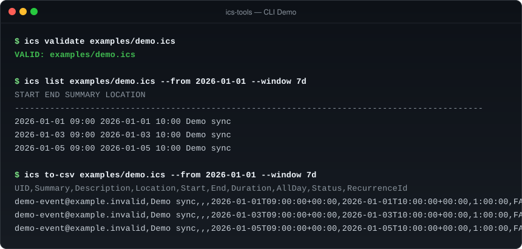

# ics-tools

[](https://github.com/YusufBeratZengin/ics-tools/actions/workflows/ci.yml)
[](https://pypi.org/project/ics-tools/)
[](LICENSE)
[](pyproject.toml)
[](pyproject.toml)

Parse, merge, filter, validate, and export iCalendar (.ics) files, with recurring event expansion.

[English](README.md) | [Türkçe](README.tr.md)



## Why ics-tools?

- **Zero runtime dependencies**: Built exclusively with Python standard library modules (`zoneinfo`, `re`, `datetime`, `csv`, `argparse`). Instant installation, zero supply-chain risk, and ultra-lightweight footprint.
- **Local & privacy-first**: Every operation runs entirely offline on your local machine. Calendar entries, locations, and attendee notes never leave your computer.
- **Comprehensive recurrence engine**: Robust RFC 5545 RRULE expansion (DAILY, WEEKLY, MONTHLY, YEARLY) with support for INTERVAL, COUNT, UNTIL, BYDAY (with numeric ordinals), BYMONTH, BYSETPOS, EXDATE, RDATE, and RECURRENCE-ID exception overrides.

## Quick start

Requires Python 3.10 or later. Install directly from source or package:

```sh
# Install from repository root
python -m pip install .

# Validate an iCalendar file
ics validate examples/demo.ics

# List expanded events for a 7-day window
ics list examples/demo.ics --from 2026-01-01 --window 7d
```

> The installed CLI command is `ics`. You can also execute it as `python -m ics_tools`.

## Usage examples

### Command-line interface (CLI)

```sh
# 1. Validate RFC 5545 compliance (returns exit code 0 on valid, 1 on error)
ics validate examples/demo.ics

# 2. Merge multiple calendars with automatic deduplication
ics merge examples/demo.ics examples/demo.ics -o is/merged.ics

# 3. Filter events by date range and case-insensitive keyword match
ics filter examples/demo.ics --from 2026-01-01 --to 2026-01-07 --match Demo -o is/filtered.ics

# 4. List expanded occurrences with target timezone translation
ics list examples/demo.ics --from 2026-01-01 --window 30d --tz Europe/Istanbul

# 5. Export expanded event occurrences to CSV
ics to-csv examples/demo.ics --from 2026-01-01 --window 30d --tz Europe/Istanbul -o is/events.csv

# 6. Export raw calendar records directly to CSV without expansion
ics to-csv examples/demo.ics --raw -o is/events-raw.csv
```

**CLI Notes:**
- Filter, list, and to-csv accept `-` or omitted file arguments to read from standard input (`stdin`).
- When `-o` / `--output` is omitted, results are emitted to standard output (`stdout`).
- CSV output columns: `UID`, `Summary`, `Description`, `Location`, `Start`, `End`, `Duration`, `AllDay`, `Status`, and `RecurrenceId`.

### Python API

```python
from datetime import date
from pathlib import Path
from ics_tools import (
    expand_event,
    export_to_csv,
    filter_calendar,
    merge_calendars,
    parse_calendar,
    serialize_calendar,
    validate_calendar,
)

# Parse from a file path, raw string, UTF-8 bytes, or text stream
calendar = parse_calendar(Path("examples/demo.ics"))

# Expand recurring events within a bounded time window
occurrences = expand_event(calendar.events[0], date(2026, 1, 1), date(2026, 1, 7))
assert len(occurrences) == 3

# Merge calendars with conflict resolution (UID + RECURRENCE-ID deduplication)
merged = merge_calendars([calendar, calendar])

# Filter events by text regex and date bounds
filtered = filter_calendar(merged, pattern="Demo")

# Validate calendar RFC 5545 conformance
result = validate_calendar(serialize_calendar(filtered))
assert result.is_valid

# Export to CSV (returns CSV string or writes directly to a stream)
csv_text = export_to_csv(filtered, window_start=date(2026, 1, 1), window_end=date(2026, 1, 7))
assert "Demo sync" in csv_text
```

## Configuration & options

### CLI parameters

| Option | Command | Description |
| --- | --- | --- |
| `--from`, `--to` | `filter`, `list`, `to-csv` | ISO 8601 date (`YYYY-MM-DD`) or datetime (`YYYY-MM-DDTHH:MM:SSZ`). Dates imply midnight UTC. |
| `--window` | `list`, `to-csv` | Shorthand duration window: `30d` (days), `2w` (weeks), `24h` (hours), or `1m` (30 days). Explicit `--to` overrides this. |
| `--tz` | `list`, `to-csv` | Target IANA timezone identifier (e.g. `Europe/Istanbul`, `America/New_York`) or supported Windows timezone name. |
| `--match` | `filter` | Regular expression matching against `SUMMARY`, `DESCRIPTION`, `LOCATION`, and `CATEGORIES`. |
| `-i`, `--case-sensitive` | `filter` | Enforce case-sensitive regex matching (case-insensitive by default). |
| `--raw` | `to-csv` | Export raw event records without expanding recurring series. |
| `-o`, `--output` | `merge`, `filter`, `to-csv` | Destination file path. Parent directories are created automatically. |

### Recurrence rules & spec support

| Feature | Support Level |
| --- | --- |
| **Frequencies** | `DAILY`, `WEEKLY`, `MONTHLY`, `YEARLY` |
| **Rule parts** | `INTERVAL`, `COUNT`, `UNTIL`, `BYDAY` (including numeric ordinals like `2MO`, `-1FR`), `BYMONTHDAY`, `BYMONTH`, `BYSETPOS`, `WKST` |
| **Exceptions** | `EXDATE`, `RDATE` (`VALUE=DATE` and `VALUE=DATE-TIME`), and `RECURRENCE-ID` overrides (including cancellations) |

## FAQ & Limitations

### How does deduplication work?
`merge_calendars` identifies unique records by `(UID, RECURRENCE-ID)`. When a conflict is found, the winning record is selected using deterministic precedence:
1. Higher `SEQUENCE` number.
2. Later `LAST-MODIFIED` timestamp.
3. Later `DTSTAMP` timestamp.
4. Input list order (later input replaces earlier).

### How is line folding and serialization handled?
`serialize_calendar` orders properties deterministically, folds lines at 75 octets on UTF-8 character boundaries (avoiding splitting multibyte sequences), and terminates all lines with CRLF (`\r\n`) in accordance with RFC 5545 Section 3.1. Missing `DTSTAMP` properties are assigned on initial serialization and preserved across consecutive writes.

### How are timezones resolved?
Resolution prioritizes the standard Python `zoneinfo` module against system IANA definitions. If a TZID is not found or the system database is unavailable (common on minimal Windows installations), `ics-tools` resolves standard Windows timezone aliases and inspects embedded `VTIMEZONE` components as a fallback. Unresolved timezones fall back to UTC with a logged warning.

### What are the design limits?
- **RFC 5545 subset**: Focuses on calendar operations. Frequencies below `DAILY` (e.g. `HOURLY`, `MINUTELY`), `RDATE` period ranges (`PERIOD`), and `RANGE=THISANDFUTURE` are outside current scope.
- **Offline privacy**: Processing is 100% offline; network requests are never initiated.
- **Unbounded generation**: Infinite recurrence generators should always be consumed with an expansion window, `COUNT`, or `UNTIL` bound.

## Contributing

Contributions, bug reports, and suggestions are welcome!

### Development setup

```sh
# Clone repository
git clone https://github.com/YusufBeratZengin/ics-tools.git
cd ics-tools

# Install development dependencies in editable mode
python -m pip install -e ".[dev]"

# Run code style and linter
python -m ruff check .

# Run static type checker
python -m mypy src tests

# Run test suite with branch coverage reporting
python -m pytest --cov=ics_tools --cov-report=term-missing

# Verify package build and metadata
python -m build
python -m twine check dist/*
```

Please review:
- [CONTRIBUTING.md](CONTRIBUTING.md) for code style guidelines and pull request workflows.
- [CODE_OF_CONDUCT.md](CODE_OF_CONDUCT.md) for community participation standards.
- [SECURITY.md](SECURITY.md) for vulnerability reporting procedures.

## License

This project is licensed under the [MIT License](LICENSE).  
Copyright (c) 2026 Yusuf Berat Zengin.
